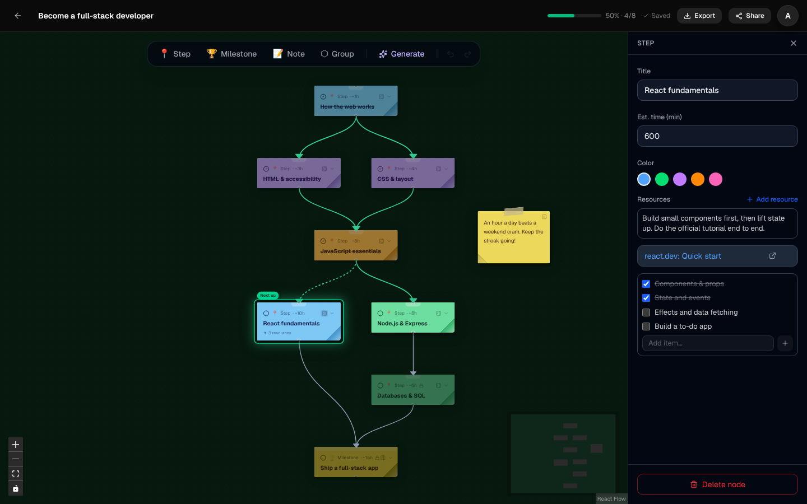
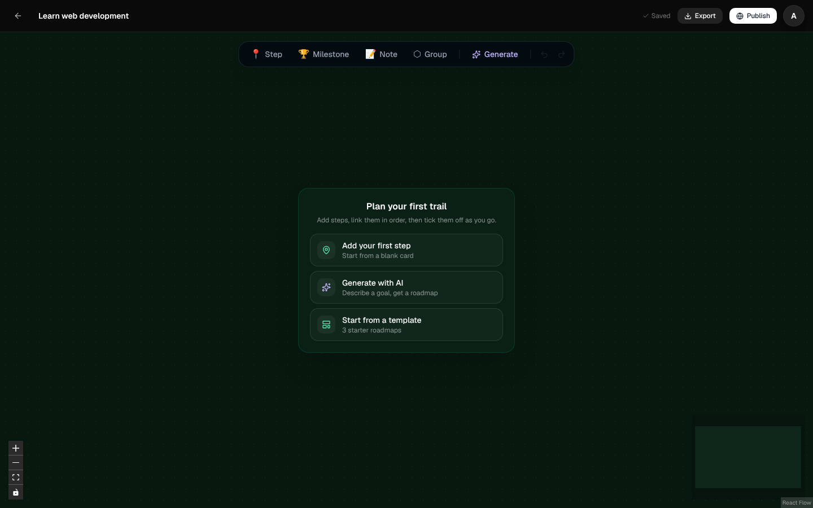
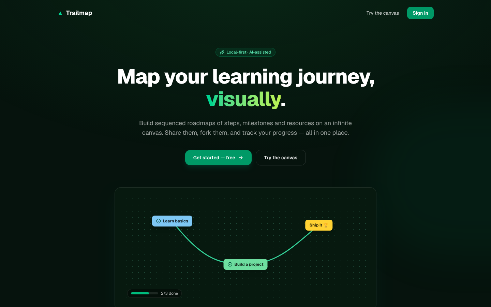

<p align="center">
  
</p>

<h1 align="center">Trailmap</h1>

<p align="center">
  Build learning roadmaps as a visual trail of steps and milestones, track your progress, and share them with anyone.
</p>

<p align="center">
  
</p>

> Screenshots throughout this README use synthetic data.

## Features

**A canvas for your learning path.** Steps, milestones, notes and groups live on an infinite canvas. Connect them in order and Trailmap keeps the graph acyclic, so prerequisites always make sense. Each step can hold resources: rich-text notes, links, YouTube videos, images and checklists.

**See where you are.** Tick steps off as you go:
- Edges along the trail you've finished turn green.
- The next unlocked step glows with a "Next up" tag.
- Steps whose prerequisites aren't done yet are dimmed and locked.
- Finishing a roadmap sets off confetti.

<p align="center">
  
</p>

**A dashboard that brings you back.** Each visit opens on:
- a "Pick up where you left off" card that jumps straight to your next step;
- a daily streak and a 7-day activity chart;
- your progress on every roadmap.

<p align="center">
  
</p>

**Start in seconds.** A new roadmap offers three ways in:
- add your first step;
- describe a goal and let AI draft the roadmap;
- start from a template.

| Blank roadmap | From a template |
| --- | --- |
|  |  |

**Share and fork.** Publish a roadmap to get a public read-only link. It works on phones. Signed-in visitors can track their own progress on it or fork it into their account. Shared links unfurl with a preview card on WhatsApp, Slack, iMessage and X. Roadmaps also export to PNG, PDF or JSON.

| Shared roadmap on a phone | Link preview |
| --- | --- |
|  |  |

**Local-first.** `/try` gives anyone a full canvas with no account. It saves to the browser (IndexedDB), and after signing in you can move those roadmaps into your account in one click.

<p align="center">
  
</p>

## Tech stack

| | |
| --- | --- |
| **Frontend** (`frontend/`) | Next.js 16 (App Router), React 19, Tailwind CSS v4, React Flow (`@xyflow/react`), Zustand + zundo (undo/redo), TanStack Query, TipTap, Dexie (IndexedDB), NextAuth v5 (JWT sessions) |
| **Backend** (`backend/`) | Express, Prisma 7 with the Neon serverless driver, Postgres (Neon), Cloudinary (image uploads), LangChain + OpenRouter (AI generation), Zod |
| **Hosting** | Frontend on Vercel, backend on Railway |

The browser only talks to the Next.js app. Signed-in API calls go through a same-origin proxy (`frontend/app/api/proxy/[...path]`), which turns the httpOnly session cookie into a Bearer token for the backend. The backend verifies that token with the shared `AUTH_SECRET`, so there's no session table. [`ARCHITECTURE.md`](ARCHITECTURE.md) covers the design in depth: data model, API contract, sync strategy and AI pipeline.

```
.
├── frontend/          Next.js app (UI, auth, API proxy)
│   ├── app/           Routes: /, /try, /login, /dashboard, /roadmap/[id], /r/[slug]
│   ├── components/    Canvas, nodes, content blocks, dashboard, landing
│   ├── store/         Zustand stores (canvas, progress, UI)
│   └── lib/           API client, local DB, path state, templates
├── backend/           Express REST API
│   ├── src/routes/    roadmaps, public (/r), progress, ai, uploads, youtube
│   └── prisma/        Database schema
└── docs/screenshots/  Images used in this README
```

## Running locally

### Prerequisites

- Node.js 22 or newer
- A [Neon](https://neon.tech) Postgres database. The backend uses Neon's serverless (WebSocket) driver, so a plain local Postgres won't work without swapping the Prisma adapter in `backend/src/db/prisma.ts`.
- Optional:
  - Google OAuth credentials, for sign-in in production. Development has a built-in dev login.
  - A Cloudinary account, for image uploads.
  - An OpenRouter key, for AI generation.

### 1. Backend

```bash
cd backend
npm ci                 # also runs prisma generate
# create .env with the values below
npx prisma db push     # create the tables in your database
npm run dev            # http://localhost:4000
```

`backend/.env`:

```bash
PORT=4000                                  # the frontend expects 4000 by default
DATABASE_URL=postgresql://…neon.tech/…     # Neon connection string
AUTH_SECRET=…                              # same value as the frontend; 32+ characters
FRONTEND_ORIGIN=http://localhost:3000      # for CORS

# Optional
CLOUDINARY_CLOUD_NAME=
CLOUDINARY_API_KEY=
CLOUDINARY_API_SECRET=
OPENROUTER_API_KEY=
OPENROUTER_MODEL=                          # defaults to a free OpenRouter model
```

### 2. Frontend

```bash
cd frontend
npm ci
npx prisma generate
npm run dev            # http://localhost:3000
```

`frontend/.env.local`:

```bash
AUTH_SECRET=…                              # same value as the backend
BACKEND_URL=http://localhost:4000

# Optional
AUTH_GOOGLE_ID=
AUTH_GOOGLE_SECRET=
NEXT_PUBLIC_SITE_URL=https://your-domain   # absolute URLs for share previews, sitemap, robots
```

Generate a secret with `openssl rand -hex 32`.

In development the login page has a **dev login** that accepts any email, so you can try every signed-in feature without Google credentials. Production builds only offer Google.

### Checks

```bash
cd frontend && npx eslint && AUTH_SECRET=x npx next build
cd backend && npx tsc --noEmit
```

## Deployment

- **Frontend (Vercel):**
  - Set the project root to `frontend/`.
  - Set `AUTH_SECRET`, `BACKEND_URL`, `AUTH_GOOGLE_ID`, `AUTH_GOOGLE_SECRET` and `NEXT_PUBLIC_SITE_URL`.
  - Without `NEXT_PUBLIC_SITE_URL`, link previews fall back to the Vercel production domain.
- **Backend (Railway):**
  - Set the root to `backend/`. The build command is `npm run build` and the start command is `npm start`.
  - Set the variables from `backend/.env`, with `FRONTEND_ORIGIN` set to the frontend's URL.
